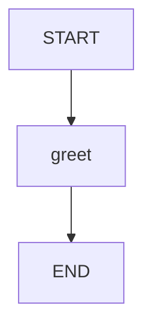
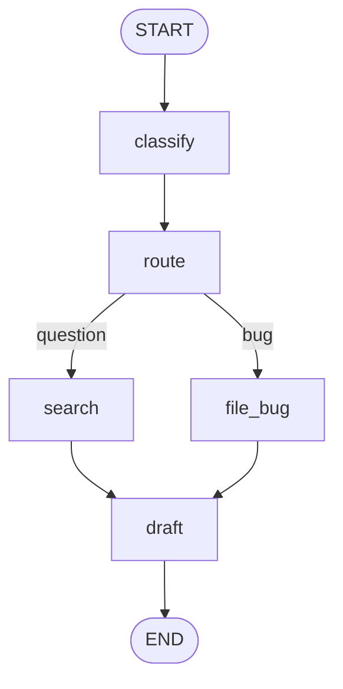

# L02 · Your first StateGraph

> **Module M48 (part 2) · ~3h**
> Goal: build, run, and *see* a graph. Every API in this lesson is one you will
> use on every project.

---

## 0. The shape of the code

Every LangGraph program has the same skeleton:

```python
from langgraph.graph import StateGraph, START, END

builder = StateGraph(State)      # 1. describe the state
builder.add_node("a", node_a)    # 2. add the nodes
builder.add_edge(START, "a")     # 3. wire the edges
builder.add_edge("a", END)
graph = builder.compile()        # 4. compile
result = graph.invoke(input)     # 5. run
```

Steps 1–3 are *declaration*. Step 4 turns the declaration into an executable
object. Step 5 runs it.

The critical mental model:

> **`StateGraph` is a builder, not a runner. `compile()` produces the runner.**

Nothing executes until `compile()`. You can keep mutating the builder until
you compile.

---

## 1. The five imports you need

```python
from langgraph.graph import StateGraph, START, END
```

| Name         | What it is                               |
| ------------ | ---------------------------------------- |
| `StateGraph` | the builder class                        |
| `START`      | sentinel node name meaning "graph entry" |
| `END`        | sentinel node name meaning "graph exit"  |

`START` and `END` are just `str` constants under the hood. You could write
`builder.add_edge("__start__", "a")` and it would work — but don't, because
the string constants are the API and the literal strings are an implementation
detail.

---

## 2. A complete, tiny graph

```python
from typing_extensions import TypedDict
from langgraph.graph import StateGraph, START, END

class State(TypedDict):
    name: str
    greeting: str

def greet(state: State) -> dict:
    return {"greeting": f"Hello, {state['name']}!"}

builder = StateGraph(State)
builder.add_node("greet", greet)
builder.add_edge(START, "greet")
builder.add_edge("greet", END)

graph = builder.compile()
print(graph.invoke({"name": "Ada"}))
# {'name': 'Ada', 'greeting': 'Hello, Ada!'}
```

Read that output carefully:

- `name` is in the output because it was **in the input** and nothing removed it.
- `greeting` is in the output because `greet` **returned** it.
- The node returned `{"greeting": ...}` — only the key it changed. LangGraph
  merged that partial update into the existing state.

That merge behaviour is the whole of **reducers**, which is L04. For now,
just internalise: *node returns a partial update; LangGraph merges it.*

---

## 3. `add_node` — the full signature (v1.2)

```python
builder.add_node(
    "name",                 # the node's name in the graph
    action,                 # the function to run
    *,
    defer=False,            # run only after the whole superstep is otherwise done
    metadata=None,          # arbitrary metadata for tracing
    input_schema=None,      # restrict what this node can read
    retry_policy=None,      # RetryPolicy(...)  -> L12
    cache_policy=None,      # CachePolicy(...)   -> L12
    error_handler=None,     # recovery branch after retries exhaust -> L12
    destinations=None,      # (("a","b"),) -> allowed targets for Command routing
    timeout=None,           # float | timedelta | TimeoutPolicy -> L12
)
```

Two call styles:

```python
builder.add_node("greet", greet)                 # named
builder.add_node(greet)                          # name inferred from function
```

`add_node` returns `self`, so calls chain:

```python
graph = (
    StateGraph(State)
    .add_node("greet", greet)
    .add_edge(START, "greet")
    .add_edge("greet", END)
    .compile()
)
```

### What a node may look like

```python
def node_a(state: State) -> dict: ...                 # sync, plain
async def node_b(state: State) -> dict: ...            # async
def node_c(state: State, runtime: Runtime) -> dict: ... # with runtime (context/store)
def node_d(state: State) -> Command: ...               # update AND route (L05)
def node_e(state: State) -> Command[Literal["x","y"]]:# ...with typed destinations
```

The return value is a **partial state update**: a `dict`.

> **Node names are part of your API.** They appear in the Mermaid diagram, in
> Studio, in traces, and in `Command(goto=...)`. Use snake_case, no spaces.
> `classify_ticket` beats `"Classify Ticket"`.

---

## 4. `add_edge` — unconditional transitions

```python
builder.add_edge("a", "b")     # after a, always go to b
```

`add_edge` also accepts a **list** as the start key, which is the fan-in
primitive:

```python
builder.add_edge(["a", "b"], "c")   # c runs after BOTH a and b finish
```

That single line is the entire "join" mechanism. In a superstep model it
means: *`c` is scheduled in the superstep after the one containing both `a`
and `b`.* (L08.)

### `START` and `END`

```python
builder.add_edge(START, "first_node")
builder.add_edge("last_node", END)
```

There are two convenience shortcuts:

```python
builder.set_entry_point("first_node")   # == add_edge(START, "first_node")
builder.set_finish_point("last_node")   # == add_edge("last_node", END)
```

> **Common mistake:** forgetting the `START` edge. This is caught at
> **compile time** with a clear message:
> `ValueError: Graph must have an entrypoint: add at least one edge from START to another node`.

> **Common mistake:** adding a cycle without an exit. You get
> `GraphRecursionError: Recursion limit of 10007 reached without hitting a
> stop condition.` This is a *loop* problem, not an `END` problem.

---

## 5. `add_sequence` — the fast path for linear graphs

For a straight line of nodes, this is tidier than N `add_edge` calls:

```python
builder = StateGraph(State)
builder.add_sequence([node_a, node_b, node_c])   # a -> b -> c
builder.add_edge(START, "a")
builder.add_edge("c", END)
```

`add_sequence` also accepts `(name, function)` tuples:

```python
builder.add_sequence([("a", node_a), ("b", node_b)])
```

> **Gotcha (verified by running it):** `add_sequence` takes **callables**, not
> bare name strings. `add_sequence(["a", "b"])` raises
> `TypeError: Expected a Runnable, callable or dict. Instead got an
> unsupported type: <class 'str'>`.
> Also: if a node has a custom `input_schema` (L03), you must add it with
> `add_node(...)` and wire it with `add_edge(...)` — `add_sequence` would
> drop the schema.

---

## 6. `compile()` — what you get

```python
graph = builder.compile(
    checkpointer=None,      # persistence (L06)
    store=None,             # long-term memory store (L07)
    cache=None,             # node cache (L12)
    interrupt_before=None,  # debugging aid
    interrupt_after=None,   # debugging aid
    debug=False,
    name=None,              # graph name (shows up in traces/Studio)
    transformers=None,      # stream transformers
)
```

`compile()` returns a `CompiledStateGraph`, which is a **Runnable**. That
means it composes with the rest of LangChain:

```python
from langchain_core.runnables import RunnableLambda

chain = RunnableLambda(lambda x: x["name"]) | graph
```

and it can be used as a node inside another graph (L11) or as a tool.

---

## 7. Running the graph

```python
result = graph.invoke({"name": "Ada"})          # run to completion, return final state
```

Other entry points on the compiled graph:

```python
graph.invoke(input, config=...)      # with a RunnableConfig
graph.invoke(input, context=...)     # with runtime context (L07)
graph.stream(input)                  # yields per-superstep updates (L09)
graph.ainvoke(input)                 # async
graph.astream(input)                 # async streaming
graph.get_state(config)              # read the current state of a thread (L06)
graph.update_state(config, values)   # write to a thread (L06)
graph.get_state_history(config)      # list past checkpoints (L06)
```

---

## 8. Seeing the graph: `get_graph().draw_mermaid()`

This is the single most useful debugging tool you have, and it is one line.

```python
print(graph.get_graph().draw_mermaid())
```

For the two-node graph above:



### The Mermaid you will actually see



How to read it:

| Element                                 | Meaning                                           |
| --------------------------------------- | ------------------------------------------------- |
| `__start__([START])` / `__end__([END])` | the sentinels, drawn as rounded/oval              |
| `a --> b`                               | **unconditional** edge: `b` always runs after `a` |
| `a -->                                  | label                                             |
| multiple arrows out of one node         | a **branch point** (fan-out)                      |
| multiple arrows into one node           | a **join point** (fan-in)                         |

Conditional edges always get the router's return value as the edge label. That
label is the *branch name*, and it must match either a node name or a key in
the router's `path_map` (L05).

> **Tip:** `draw_mermaid()` returns a string. Paste it into any Mermaid
> renderer (GitHub markdown, mermaid.live, VS Code's Markdown Preview) to get
> a picture. `draw_mermaid_png()` also works but needs `pyppeteer` installed.

---

## 9. Building the L01 exercise for real

Now let's build a real multi-node graph. This is `examples/L02_first_graph.py`.

```python
from typing_extensions import TypedDict
from langgraph.graph import StateGraph, START, END

class TriageState(TypedDict):
    ticket: str
    category: str
    doc_snippets: list[str]
    draft: str

def read_ticket(state):      return {"ticket": state["ticket"].strip()}
def classify(state):         return {"category": "question"}
def search_docs(state):      return {"doc_snippets": ["Reset: Settings > Security"]}
def draft_reply(state):      return {"draft": "Here is how to reset it..."}
```

Then wire it, compile it, run it, and draw it.

### A graph with a branch

```python
builder = StateGraph(TriageState)
builder.add_node("read_ticket", read_ticket)
builder.add_node("classify", classify)
builder.add_node("search_docs", search_docs)
builder.add_node("file_bug", file_bug)
builder.add_node("draft_reply", draft_reply)

builder.add_edge(START, "read_ticket")
builder.add_edge("read_ticket", "classify")
builder.add_conditional_edges("classify", route, {
    "question": "search_docs",
    "bug": "file_bug",
})
builder.add_edge("search_docs", "draft_reply")
builder.add_edge("file_bug", "draft_reply")
builder.add_edge("draft_reply", END)
```

`add_conditional_edges(source, path, path_map)`:

- `source` — the node the branch happens *after*
- `path` — a callable (or Runnable) that receives the state and returns a
  **branch name**
- `path_map` — an optional `dict` translating branch name → node name

With the `path_map`, the router can return stable business labels
(`"question"`, `"bug"`) that are decoupled from node names. Without it, the
router must return node names directly.

---

## 10. Common beginner errors and what they look like

These were **verified by running them** in `examples/L02_first_graph.py`:

| Symptom                                                                                       | Cause                                                                              | Fix                                    |
| --------------------------------------------------------------------------------------------- | ---------------------------------------------------------------------------------- | -------------------------------------- |
| `ValueError: Graph must have an entrypoint: add at least one edge from START to another node` | no edge from `START`                                                               | add `add_edge(START, ...)`             |
| `GraphRecursionError: Recursion limit of 10007 reached`                                       | a **cycle** with no way out                                                        | add an exit edge, or route to `END`    |
| `InvalidUpdateError: At key 'x': Can receive only one value per step`                         | two nodes in the **same superstep** wrote the same key and that key has no reducer | add a reducer (L04)                    |
| `ValueError: Found edge starting at unknown node 'x'`                                         | typo in a node name                                                                | names are exact strings                |
| Output missing a key you returned                                                             | key not in the state schema                                                        | add it to `State`                      |
| `KeyError` inside a node                                                                      | you read a key that was never written                                              | `state.get("k", default)` for optional |

> **Correction to a very common belief:** forgetting `add_edge(node, END)` is
> **not** an error. If a node simply has no outgoing edge, the graph finishes
> there and returns the state as-is. It is only a problem if you *meant* the
> run to continue. `END` is the explicit "I am done" marker — useful for
> clarity and for `Command(goto=END)`, but not mandatory.
>
> Likewise, `GraphRecursionError` means a **loop**, not a missing `END`. If
> your graph has no cycle and you get a recursion error, you have a cycle you
> did not notice.

---

## 11. Checkpoint

- [ ] I can write the 5-line skeleton of a LangGraph program from memory.
- [ ] I know `StateGraph` is a builder and `compile()` produces the runner.
- [ ] I know a node returns a **partial update**, not the full state.
- [ ] I can add nodes, edges, sequences, `START`/`END` without looking it up.
- [ ] I can produce a Mermaid diagram and read it.
- [ ] I know what `EmptyInputError` and `GraphRecursionError` usually mean.
- [ ] I can build a multi-branch graph with `add_conditional_edges` + `path_map`.

---

**Next → [L03 · State & schema types](./L03-state-schemas.md)** — TypedDict vs
Pydantic vs dataclass, splitting input/output schemas, and private state.
