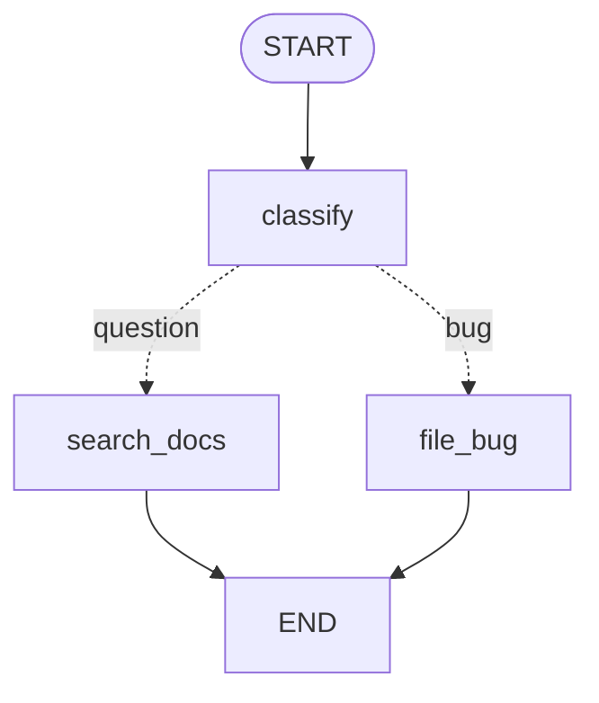

# L05 · Routing: conditional edges and `Command`

> **Module M48 (part 3) · ~2.5h**
> Goal: control exactly where a run goes next — and know which of the two
> modern styles to reach for.

---

## 1. Two ways to route

LangGraph gives you two mechanisms for "go here next". Both are current and
supported. They differ in *where the decision lives*.

|                                    | `add_conditional_edges`     | `Command`                            |
| ---------------------------------- | --------------------------- | ------------------------------------ |
| Decision lives in                  | a separate router function  | **the node itself**                  |
| Node returns                       | a plain state update        | a `Command` with `update=` + `goto=` |
| Node does state update AND routing | needs two mechanisms        | one object, one return               |
| Can route to a *subgraph*          | no                          | yes (`Command(graph=...)`)           |
| Can fan out dynamically            | via `Send` in the router    | `Command(goto=[Send(...), ...])`     |
| Static type checking of targets    | no                          | yes, with `Command[Literal[...]]`    |
| Graph diagram shows the branch     | ✅ as a dashed labelled edge | ✅ as a dashed labelled edge          |

**Modern guidance (LangGraph 1.x):** the official docs increasingly use
`Command` because it keeps the update and the routing decision together, in
one place, with one return statement. `add_conditional_edges` is still fully
supported and is still the clearest choice when the routing logic is a
genuinely separate concern (and when you want the router to be unit-testable
on its own).

**Rule of thumb**

- Router is a *pure function of state* and you like testing it alone → `add_conditional_edges`.
- The node also produces state updates → `Command`.
- You need to route into a subgraph or fan out with `Send` → `Command`.
- You want static checking that `goto` targets exist → `Command[Literal[...]]`.

---

## 2. `add_conditional_edges` — the full picture

```python
builder.add_conditional_edges(
    source,                 # the node AFTER which the branch happens
    path,                   # callable | Runnable -> branch name(s)
    path_map=None,          # dict[str, str] | list[str] | None
)
```

### The router

```python
def route(state: State) -> str:
    return "search_docs"     # a BRANCH NAME
```

It receives the state and returns one branch name (or a list of them for a
fan-out).

### `path_map` — decoupling business labels from node names

```python
builder.add_conditional_edges(
    "classify",
    route,                              # returns "question" / "bug" / "billing"
    {
        "question": "search_docs",     # business label -> node name
        "bug": "file_bug",
        "billing": "escalate",
    },
)
```

**Why this matters.** Business labels survive refactors. If you rename the
node `search_docs` to `retrieve_knowledge`, you change one entry in the path
map, not every router that returns `"search_docs"`.

Without a `path_map`, the router must return node names directly. With a
`path_map` given as a **list**, the branch names *are* the node names:

```python
builder.add_conditional_edges("classify", route, ["search_docs", "file_bug"])
```

### Seeing it in the diagram



The dashed edges are conditional; the **label is what the router returned**.
If a label appears that you did not expect, your router returned something
surprising — this is a great debugging signal.

> **Verified difference in the rendered diagram:**
>
> - `add_conditional_edges` renders the branch **label**:
>   `classify -. &nbsp;question&nbsp; .-> search_docs;`
> - `Command(goto=...)` renders an **unlabelled** dashed edge:
>   `classify -.-> search_docs;`
>
> So if you are using `Command` and want the branch names visible in the
> diagram, name your nodes after the business branches, or keep the labels in
> your code comments. The label is *not* lost — it is simply not rendered for
> `Command`-based routing.

### The router can be a Runnable

```python
from langchain_core.runnables import RunnableLambda

builder.add_conditional_edges(
    "classify",
    RunnableLambda(lambda s: "search_docs" if s["score"] > 0.8 else "file_bug"),
)
```

### A router can return a list (fan-out)

```python
def route(state) -> list[str]:
    return ["search_docs", "notify"]     # both run, in parallel
```

---

## 3. `Command` — update and route in one object

```python
from langgraph.types import Command

def classify(state: State) -> Command:
    category = do_classification(state)
    return Command(
        update={"category": category},   # state update
        goto="search_docs",              # where to go next
    )
```

Full signature (LangGraph 1.2):

```python
Command(
    *,
    graph: str | None = None,   # route to a node in a NAMED SUBGRAPH
    update: Any | None = None,  # the state update
    resume: dict | Any | None = None,  # value to deliver to an interrupt()
    goto: Send | Sequence[Send | N] | N = (),  # next node(s)
)
```

### Why `Command` is the modern style

With `add_conditional_edges`, a node that needs to both update state and
route has to be split:

```python
# OLD STYLE - two mechanisms, two places
def classify(state):
    return {"category": do_classification(state)}

def route(state):
    return "search_docs" if state["category"] == "question" else "file_bug"

builder.add_node("classify", classify)
builder.add_conditional_edges("classify", route, {...})
```

The decision is now split across two functions, and the router can only see
state *after* the update. With `Command`:

```python
# MODERN STYLE - one function, one return
def classify(state) -> Command:
    category = do_classification(state)
    goto = "search_docs" if category == "question" else "file_bug"
    return Command(update={"category": category}, goto=goto)
```

The decision is made with the fresh value in hand, in one place.

### Typed destinations — static checking

```python
from typing import Literal

def classify(state: State) -> Command[Literal["search_docs", "file_bug"]]:
    ...
```

The type parameter tells your editor and type-checker which nodes are legal
targets. A typo in `goto=` becomes a type error, not a runtime surprise.

### `destinations` on `add_node`

For nodes that route via `Command`, you can also declare the allowed targets
on the node itself:

```python
builder.add_node(
    "classify",
    classify,
    destinations=("search_docs", "file_bug"),
)
```

This shows up in the Mermaid diagram, which makes the graph easier to read.

### Routing with `Send` (dynamic fan-out) — preview of L08

```python
from langgraph.types import Send

def fan_out(state) -> Command:
    return Command(goto=[Send("process", {"doc": d}) for d in state["docs"]])
```

### Routing inside a named subgraph — preview of L11

```python
return Command(graph="worker", goto="next_step")
```

`graph=` names the subgraph to route into; `goto=` names the node *inside*
that subgraph.

### `Command(resume=...)` — Phase 8 preview

When a graph is paused by `interrupt()`, the resuming call supplies the value:

```python
graph.invoke(Command(resume="approved"), config)   # the interrupt() returns "approved"That is Phase 8 (human-in-the-loop). Noted here so `Command` is not a
```

That is Phase 8 (human-in-the-loop). Noted here so `Command` is not a
mystery later.

---

## 4. `Command` and state updates — a subtlety

`Command(update={...})` goes through the **same reducers** as a normal node
return. So:

```python
return Command(update={"messages": [AIMessage("hi")]})
```

appends to `messages` if `messages` has the `add_messages` reducer, and
**overwrites** if it does not. `Command` does not bypass reducers.

`Overwrite` still works inside a `Command`:

```python
return Command(update={"events": Overwrite([])}, goto="next")
```

---

## 5. Choosing your style — a decision table

| Situation                                                                        | Use                                  |
| -------------------------------------------------------------------------------- | ------------------------------------ |
| Router is a separate, testable policy function                                   | `add_conditional_edges`              |
| Node must update state **and** route                                             | `Command`                            |
| You want the compiler to check `goto` targets                                    | `Command[Literal[...]]`              |
| Branch labels are business concepts, node names are implementation               | `add_conditional_edges` + `path_map` |
| Route into a subgraph                                                            | `Command(graph=..., goto=...)`       |
| Fan out to a dynamic number of nodes                                             | `Command(goto=[Send(...), ...])`     |
| A node may route to one of several targets depending on a value it just computed | `Command`                            |

**Both are fine.** Mixing them in one graph is normal — LangGraph supports it.

---

## 6. Loops are just edges

There is no special "loop" API. A cycle is a graph where an edge points
backwards:

```python
builder.add_edge("tools", "agent")     # agent -> tools -> agent
```

Every iteration of that cycle is a new **superstep**, and the `recursion_limit`
counts them (L06). A loop needs a *termination condition*, and the cleanest
way to express it is a conditional edge that routes to `END`:

```python
def should_continue(state) -> str:
    last = state["messages"][-1]
    if isinstance(last, AIMessage) and not last.tool_calls:
        return "end"
    return "tools"

builder.add_conditional_edges(
    "agent", should_continue, {"end": END, "tools": "tools"}
)
```

This is exactly the ReAct loop you wrote in Phase 6 — except now the loop is
a *graph*, which means you can attach a retry policy to `tools`, a timeout to
`agent`, and a human approval step in the middle.

---

## 7. A full worked example

```python
from typing import Literal
from typing_extensions import TypedDict
from langgraph.graph import END, START, StateGraph
from langgraph.types import Command

class SupportState(TypedDict):
    ticket: str
    category: str
    draft: str
    escalated: bool

def classify(state: SupportState) -> Command[Literal["search_docs", "escalate"]]:
    category = "billing" if "charged" in state["ticket"].lower() else "question"
    goto = "escalate" if category == "billing" else "search_docs"
    return Command(update={"category": category}, goto=goto)

def search_docs(state: SupportState) -> Command[Literal["draft"]]:
    return Command(update={"draft": "Here is how to reset it..."}, goto="draft")

def escalate(state: SupportState) -> Command[Literal["draft"]]:
    return Command(update={"escalated": True}, goto="draft")

def draft(state: SupportState) -> Command[Literal["__end__"]]:
    return Command(update={}, goto=END)

builder = StateGraph(SupportState)
builder.add_node("classify", classify, destinations=("search_docs", "escalate"))
builder.add_node("search_docs", search_docs)
builder.add_node("escalate", escalate)
builder.add_node("draft", draft)
builder.add_edge(START, "classify")
builder.add_edge("search_docs", "draft")
builder.add_edge("escalate", "draft")
builder.add_edge("draft", END)
graph = builder.compile()
```

Note that with `Command`-based routing you do **not** call
`add_conditional_edges` — the edges from `classify` are implicit in the
`goto=` values. But the *downstream* edges (`search_docs -> draft`) are still
declared normally, because those nodes return plain updates.

**A common confusion:** if a node returns a `Command` with `goto=`, and you
*also* declared `add_edge("classify", "something")`, the `Command`'s `goto`
wins for that node. Don't declare both.

---

## 8. Debugging routing

1. **Look at the Mermaid.** The branch labels are literally what your router
   returned.
2. **Stream with `stream_mode="updates"`** — the chunk key is the node name
   that actually ran, so you see the path taken.
3. **Print the router's return value** in a unit test. Routers are pure
   functions; test them in isolation with 3-4 cases. This is the single
   highest-value test you can write in a LangGraph project.

```python
def test_route():
    assert route({"category": "bug"}) == "file_bug"
```

---

## 9. Checkpoint

- [ ] I can explain when to use `add_conditional_edges` vs `Command`.
- [ ] I can write a router with a `path_map` and explain why the path map
  decouples business labels from node names.
- [ ] I can write a node that returns `Command(update=..., goto=...)`.
- [ ] I know `Command[Literal[...]]` gives static checking of `goto` targets.
- [ ] I know `Command(update=...)` still goes through reducers.
- [ ] I know `destinations=` exists and what it does.
- [ ] I can express a ReAct loop as a cycle with a conditional exit to `END`.
- [ ] I know not to declare both `add_edge` and `Command(goto=)` for the
  same node.

---

**Next → [L06 · Config, threads, persistence and time travel](./L06-config-threads-persistence.md)**
— `thread_id`, checkpointers, `get_state`, `update_state`, and the recursion
limit.
